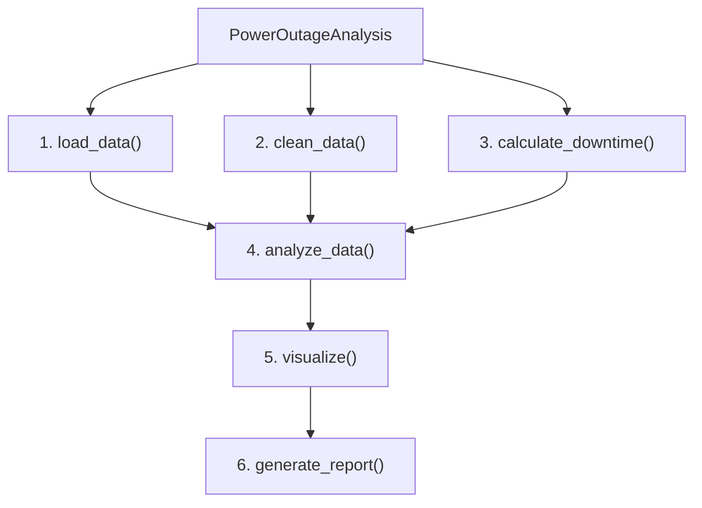

# National Power Outage Analysis (Python & OOP)

Analytical study of India's power outage patterns (2017–2024), built with an
object-oriented Python pipeline for reproducible cleaning, modeling, and
visualisation. Intended for energy analysts and engineering students.

## Problem Statement & Objective

The goal is to analyse outage behaviour across India in order to prioritise
interventions and inform operations:

- Identify states with the highest aggregated outage duration and frequency
- Determine which power-station types cause the most outages (thermal, hydro, renewables, transmission)
- Calculate average downtime by operator ownership and sector
- Compare reliability across public, private, and central utilities
- Detect temporal trends and seasonal patterns from 2017–2024

## Dataset Overview

| Source | Domain | Period | Format | File Size | Granularity |
|---|---|---|---|---|---|
| Ministry of Power, Government of India | Energy | 2017–2024 | CSV | ~240 MB | Power Station (Daily) |

| # | Column | Description |
|---|---|---|
| 1 | Date | Date of outage report |
| 2 | Region | Power grid region |
| 3 | State | State where outage occurred |
| 4 | Utility Name | Name of power utility |
| 5 | Sector | State / Private / Central |
| 6 | Station Name | Name of generating station |
| 7 | Station Type | Thermal / Hydro / Nuclear / Gas etc. |
| 8 | Unit Number | Unit under outage |
| 9 | Capacity (MW) | Installed capacity of unit |
| 10 | Outage Type | Planned or Forced outage |
| 11 | Outage Date | Date outage started |
| 12 | Expected Sync Date | Expected restoration date |
| 13 | Reason for Outage | Cause of outage |
| 14 | Capacity Under Outage (MW) | Capacity unavailable due to outage |
| 15 | Remarks | Additional notes |

> The raw CSV is not committed to this repo (see [Data](#data)). Place your
> export in `data/` before running the pipeline.

## Data Cleaning ("Noise Cleaning")

- **Missing values** — imputed or flagged depending on variable importance;
  events with missing start/end dates were excluded or handled with
  conservative imputation rules.
- **Date & time** — timestamps standardised to UTC+5:30, ISO formats parsed,
  and cross-field consistency checked (start ≤ end).
- **Duplicates & invalids** — exact duplicates removed; negative or
  implausible durations filtered; events de-duplicated by station +
  timestamp window.
- **Text normalisation** — `station_type`, `outage_type`, and `owner_type`
  labels unified into lowercase, canonical categories.

## OOP Design

The pipeline is implemented as a single `PowerOutageAnalysis` class with a
six-stage flow:



**Class diagram**

```
PowerOutageAnalysis
-------------------
- data            : DataFrame
- cleaned_data     : DataFrame
-------------------
+ load_data(file_path)          # Loads the dataset from CSV
+ clean_data()                  # Cleans missing values, duplicates, dtypes
+ calculate_downtime()          # Calculates downtime for each outage
+ analyze_data()                # Performs statistical aggregations
+ visualize(output_dir)         # Generates charts and graphs
+ generate_report(output_path)  # Writes a summary report of insights
```

## Results — Visual Summary

Running the pipeline produces:

- A **bar chart** of the top 10 reasons for power plant outages
- A **line chart** of year-wise outage counts (2017–2024)
- A **sector reliability table** (total outages, average and max downtime by sector)
- A plain-text **summary report** (`outputs/report.txt`)

### Key Quantitative Insights

- **Ownership effects** — private utilities showed lower mean downtime per
  event compared with older public assets, suggesting differences in
  maintenance cadence and asset modernity.
- **Thermal dominance** — thermal plants account for the largest share of
  cumulative outage minutes and forced outage events, driven by ageing units
  and planned maintenance clustering.
- **Forced outages** — unplanned outages account for a significant portion
  of capacity loss, concentrated in higher-capacity thermal units.
- **Worst-affected states** — high outage durations cluster in states with
  dense thermal capacity and constrained transmission corridors.

### Trends & Seasonality

- Year-to-year variability with occasional spikes tied to major forced
  events and maintenance cycles.
- Seasonal peaks during pre-monsoon and monsoon months, driven by
  weather-related transmission failures and load stress.
- Gradual improvement in certain regions where targeted asset reinvestment
  occurred.

**Recommended next step:** time-series decomposition and change-point
detection to isolate structural shifts and quantify the impact of
interventions.

## Conclusions & Operational Recommendations

1. **Data-driven prioritisation** — target high-impact states and thermal
   units for condition-based maintenance to reduce forced outages.
2. **Asset modernisation** — invest in modern controls and redundancy for
   older thermal stations to shorten downtime.
3. **Operational monitoring** — deploy near-real-time analytics from station
   objects to detect anomalies earlier.
4. **Reproducible pipeline** — maintain the OOP codebase with versioned
   datasets and tests so future analyses are auditable and extensible.

## Project Structure

```
power-outage-analysis/
├── README.md
├── LICENSE
├── requirements.txt
├── .gitignore
├── src/
│   └── power_outage_analysis.py   # PowerOutageAnalysis class + pipeline
├── data/                          # Place raw CSV export here (not committed)
└── outputs/                       # Generated charts, report, cleaned CSV
```

## Data

This repository does not include the raw dataset (it is a large Ministry of
Power export, ~240 MB). To run the pipeline yourself:

1. Obtain the daily power-outage CSV export.
2. Place it in `data/` (e.g. `data/Daily Power Outage_Sample_Data.csv`).
3. Update the file name in `src/power_outage_analysis.py` (`__main__` block)
   if yours differs.

## Getting Started

```bash
git clone https://github.com/<your-username>/power-outage-analysis.git
cd power-outage-analysis
pip install -r requirements.txt

python src/power_outage_analysis.py
```

Outputs (charts, cleaned CSV, and the text report) are written to `outputs/`.

## Tech Stack

- Python 3.10+
- pandas
- matplotlib

## License

This project is licensed under the MIT License — see [LICENSE](LICENSE) for
details.
